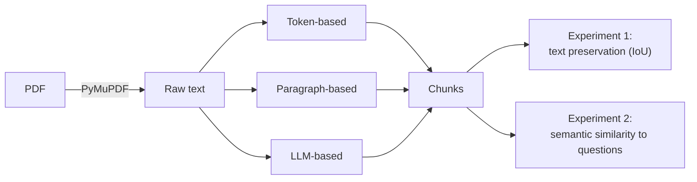

# Semantic Chunking with LLMs for Information Retrieval

Code, data and results of my bachelor thesis *"Enhancing Information Retrieval through Semantic Chunking of Text Files with Large Language Models"* (B.Sc. Computer Science, Mannheim University of Applied Sciences, 2025).

## Problem

Retrieval-Augmented Generation (RAG) systems do not search whole documents. They search small text segments, called chunks. How a document is split has a direct effect on what the retriever can find: fixed-size chunks often cut related sentences apart or mix unrelated topics.

This thesis asks:

> Can an instruction-tuned LLM split a document into semantically coherent chunks **without changing the text**, and do these chunks match user questions better than rule-based chunks?

## Approach

Three chunking strategies were compared on the same documents:

| Strategy | How it works |
|---|---|
| **Token-based** | Fixed windows of 80 words, no overlap |
| **Paragraph-based** | Text blocks as extracted by PyMuPDF |
| **LLM-based** | A few-shot prompt asks the model to insert blank lines between semantic units, without rewriting anything |

Five open-weight models (3B–8B parameters) were tested for LLM-based chunking. They were run on a local HPC cluster:

| Model | Size | Distilled |
|---|---|---|
| Mistral-7B-Instruct | 7B | no |
| Qwen2.5-3B-Instruct | 3B | no |
| Qwen2.5-7B-Instruct | 7B | no |
| DeepSeek-R1-Distill-Qwen-7B | 7B | yes |
| DeepSeek-R1-Distill-Llama-8B | 8B | yes |

### Pipeline



### Evaluation

**Dataset:** 20 synthetic PDF documents (AI-generated, short, clearly structured), each with 10 related questions, plus a shared set of 200 unrelated questions as a control.

**Experiment 1: Did the text stay the same?**
LLMs may paraphrase, drop or add content. The chunked output is aligned word by word with the original text (`difflib.SequenceMatcher`), and an Intersection-over-Union (IoU) score is computed. An IoU of 1.0 means the text is unchanged.

**Experiment 2: Do the chunks match the questions?**
Chunks and questions are embedded with `all-mpnet-base-v2` (Sentence Transformers). For each question, the highest cosine similarity across all chunks of its document is taken and then averaged.

- **Related questions:** higher is better.
- **Unrelated questions:** closer to 0 is better.

## Results

Averaged over all 20 documents:

| Method | IoU | Chunks/doc | Words/chunk | Similarity related ↑ | Similarity unrelated ↓ |
|---|---|---|---|---|---|
| Token-based | 1.00 | 3.22 | 70.2 | 0.669 | 0.031 |
| Paragraph-based | 1.00 | 3.72 | 61.6 | 0.681 | 0.025 |
| Mistral-7B-Instruct | 0.86 | 6.85 | 51.1 | 0.684 | -0.003 |
| Qwen2.5-3B-Instruct | 1.00 | 4.40 | 53.6 | 0.683 | 0.015 |
| **Qwen2.5-7B-Instruct** | **1.00** | 7.55 | 31.9 | **0.690** | -0.009 |
| DeepSeek-R1-Distill-Qwen-7B | 0.90 | 4.60 | 58.5 | 0.679 | 0.013 |
| DeepSeek-R1-Distill-Llama-8B | 0.99 | 5.35 | 50.3 | 0.687 | 0.008 |

### Key findings

- **Qwen2.5-7B-Instruct** produced the best-matching chunks and kept the text fully intact (IoU 1.0).
- **LLMs create smaller chunks** (about 30–58 words versus 62–70 for rule-based methods). This gives more precise matches but risks splitting context.
- **Not every model follows the "don't change the text" instruction.** Mistral-7B reached an IoU of 0.86. The DeepSeek-R1 distills sometimes returned their reasoning instead of chunks, so their output had to be filtered.
- **Paragraph-based chunking was a strong baseline.** On these well-structured documents it came close to the LLM results at a fraction of the cost.

## Limitations

These results should be read with care:

- **The differences are small** (0.669 vs. 0.690), and only 20 documents were tested. No significance testing was done.
- **The documents are synthetic and cleanly structured.** This favours paragraph-based chunking. Whether LLM chunking helps more on messy, real-world documents is untested.
- **Similarity to a question is a proxy.** It measures whether a matching chunk exists, not whether a RAG system answers correctly. The evaluation does not include retrieval metrics such as Recall@k or MRR, and no answers are generated.
- **Long documents are not handled.** The whole text is sent in one prompt, so documents longer than the model's context window would need to be pre-split.

## Repository structure

```
Experiment_1/                 # Chunking + text preservation (IoU)
├── all_pdfs/                 # 20 synthetic test documents
├── original_text/            # Extracted reference text
├── Token/                    # Token-based chunking
├── Absatz/                   # Paragraph-based chunking ("Absatz" = paragraph)
├── <model-name>/             # LLM-based chunking, one folder per model
│   ├── chunking.py
│   ├── chunked_text/
│   └── IoU_results/
└── IoU_test.py               # IoU computation

Experiment_2/                 # Semantic similarity evaluation
├── questions/                # 10 related questions per document + unrelated.txt
├── <method>/Related/         # Similarity results per method (CSV)
├── <method>/Unrelated/
├── Vergleiche/               # Per-document comparison of all methods (XLSX)
├── similarity.py             # Embedding + cosine similarity
├── excel.py                  # Merge related results
└── unrelated_excel.py        # Merge unrelated results
```

## Reproducing

The scripts were written as research scripts, not as a packaged tool:

- Document names, model folders and paths are set as constants at the top of each script (e.g. `FILE = "..."`).
- The LLM-based `chunking.py` scripts call a private model server on a local network that is no longer available. To rerun them, point `URL_LLM` at your own endpoint (e.g. vLLM or Ollama).
- All chunked outputs and results are included, so Experiment 2 and the IoU computation can be rerun without access to the models.

```bash
pip install pymupdf requests sentence-transformers pandas openpyxl

cd Experiment_1 && python IoU_test.py        # set FOLDER first
cd ../Experiment_2 && python similarity.py   # set FILE and paths first
```

## Tech stack

Python · PyMuPDF · Sentence Transformers (`all-mpnet-base-v2`) · pandas · Hugging Face models (Qwen2.5, Mistral, DeepSeek-R1 distills)

## Thesis

The full thesis is available as a PDF: [Bachelorthesis.pdf](thesis/Bachelorthesis.pdf)

Licensed under [CC BY-SA 4.0](https://creativecommons.org/licenses/by-sa/4.0/).
